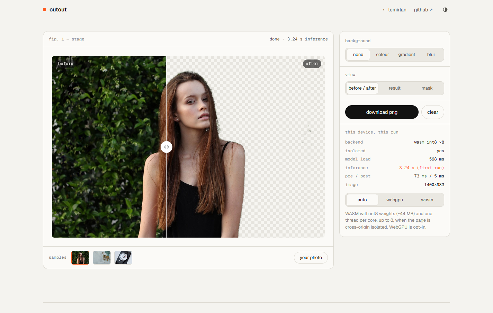

# Cutout — on-device background studio

A private, on-device photo workbench. Remove a background with AI or start manually, refine the mask with erase/restore brushes and undo, set a colour/gradient/portrait-blur scene, and export PNG or WebP. Your photo is never uploaded.

**Live demo:** https://temirlanzzz.github.io/cutout/

Original interface reference (the refinement studio redesign is described below):



## How it works

1. **Model.** [`onnx-community/ormbg-ONNX`](https://huggingface.co/onnx-community/ormbg-ONNX), the open RMBG model (ISNet, Apache-2.0). The WASM path loads the int8-quantized export (`model_quantized.onnx`, 44.3 MB); the opt-in WebGPU path loads the fp16 export (88.1 MB). Both come from the Hugging Face hub and are cached by the browser after the first visit.
2. **Runtime.** [transformers.js](https://github.com/huggingface/transformers.js) 3.8.1 from jsDelivr, which wraps ONNX Runtime Web. Inference runs in a module Web Worker (`worker.js`) so the page keeps painting.
3. **Pre/post.** The page decodes the photo (EXIF-aware), downsizes to ≤1024 px and sends raw RGBA to the worker. The processor resizes to 1024×1024 and rescales to 0–1; the model returns a soft mask (`alphas`, 0–1) which becomes an 8-bit alpha plane.
4. **Compositing.** The mask is scaled back up with bilinear filtering and applied with `destination-in`, so partial alpha at hair and edges survives. Backgrounds are painted underneath: none (checkerboard / transparent PNG), solid colour, gradient, or the original photo blurred with a canvas filter. Compositing is capped at 2048 px on the long side.
5. **Cross-origin isolation.** GitHub Pages can't send `COOP`/`COEP` headers, and without them there is no `SharedArrayBuffer`, so ONNX Runtime's WASM backend runs on one thread. A vendored [`coi-serviceworker`](https://github.com/gzuidhof/coi-serviceworker) re-serves every response with those headers after the first load. Add `?noiso` to the URL to turn it off and compare.

## Results

Measured by me in headless Chrome 155 on a Ryzen 7 255 laptop (8 cores / 16 threads), driving the page over the DevTools protocol: three sample photos plus a repeat, four passes. Times are `performance.now()` inside the worker; "inference" is the model call alone at 1024×1024.

| Setup | Model load | Inference / photo |
|---|---|---|
| WASM, int8, 8 threads, isolated via service worker, cold cache (44.3 MB download) | 7.3 s | **2.0–2.6 s** |
| same, warm cache | 0.25–0.78 s | **2.2–3.3 s** |
| WASM, int8, not isolated (`?noiso`), 1 thread | 0.63 s | 15.6–15.8 s |
| WebGPU, fp16 (88.1 MB), adapter with `shader-f16` present | 10.2 s | fails at run time, falls back to WASM |

Pre-processing took 57–109 ms and mask→alpha 2–7 ms. The first inference after a load is the slowest (up to 3.7 s in later screenshot runs).

**What I learned**

- **Isolation is a 6× switch.** Same model, same machine: ~15.7 s single-threaded vs ~2.0–2.6 s with 8 threads. On GitHub Pages that took a service worker, not a better model.
- **WebGPU being available doesn't mean the model runs on it.** The fp16 session compiled, then the first run threw `using ceil() in shape computation is not yet supported for MaxPool` (ISNet pools with `ceil_mode`). WASM is the default; WebGPU is opt-in and a failure restarts the worker on WASM. Reusing the same worker after the failure kept erroring.
- **Read the graph's I/O names.** This export takes `pixel_values` and returns `alphas`, not the `input`/`output` from most RMBG snippets; I read them from the session.
- **Local models are off in the web build** unless you say otherwise. I set `allowLocalModels = false` and fetch from the hub, and every worker error is surfaced in the page's status line so nothing fails silently.

## Run locally

```sh
git clone https://github.com/temirlanzzz/cutout
cd cutout
python -m http.server 8000
# open http://localhost:8000
```

No build step. `localhost` counts as a secure context, so the service worker (and therefore threaded WASM) works locally too. URL switches: `?backend=wasm|webgpu`, `?noiso` (disable isolation), `?sample=portrait|dog|watch` (auto-run a sample).

## Structure

```
index.html            page, demo markup, write-up
style.css             design tokens (light/dark), layout
app.js                input (drop / paste / picker / samples), compositing, divider, download
worker.js             transformers.js + ONNX Runtime Web inference, WebGPU→WASM fallback
coi-serviceworker.js  vendored v0.1.7, adds COOP/COEP on GitHub Pages
photos/               three public-domain sample photos
docs/screenshot.png   README screenshot
```

## Limits

- Hair is soft and mostly right on the portrait, but the outer strands carry a dark-green fringe from the foliage, and a few leaf specks survive in the background.
- The model's idea of "subject" is generous: it keeps the chair on the dog photo and the display cushion on the watch photo.
- Thin, low-contrast parts get partial alpha (the dog's hind legs come out partly transparent).
- The mask is 1024×1024, upscaled; on big photos edges are smoother than the pixels they cut.
- Portrait blur blurs the original including the subject, so a faint halo can show.
- First visit: 44 MB download and one automatic reload while the service worker installs. WebGPU doesn't run this export with the ONNX Runtime in transformers.js 3.8.1.

## Credits

- Model: [ORMBG](https://huggingface.co/onnx-community/ormbg-ONNX), Apache-2.0.
- Sample photos (public domain, Wikimedia Commons): [portrait](https://commons.wikimedia.org/wiki/File:Brunette_woman_portrait_(Unsplash).jpg) by Christopher Campbell, [dog](https://commons.wikimedia.org/wiki/File:Boxer_(dog)_In_Iran,_Mostafa_Meraji_04.jpg) by Mostafa Meraji, [watch](https://commons.wikimedia.org/wiki/File:Mondaine_Classic_A669.30008.16SBO_watch.jpg) by DimiTalen.

## Refinement studio

The interface now uses a lilac creative-workbench system, a dark dotted image stage, numbered tools, light/dark themes, responsive single-column controls, visible focus, and reduced-motion support. The original technical write-up and benchmark history remain below the editor.

- **Erase and restore:** paint the alpha mask with a 4–300 image-pixel brush and adjustable edge softness. Fast pointer movements interpolate a continuous stroke. Touch and pen use the same pointer workflow.
- **Undo/redo:** keep the latest 12 mask strokes in memory. Buttons or Cmd/Ctrl+Z and Cmd/Ctrl+Shift+Z. New edits clear redo; opening/clearing an image clears history.
- **Keyboard refinement:** choose a tool, focus the image, move with arrow keys (Shift moves farther), then Enter/Space to stamp the brush. The before/after divider also supports arrows, Home and End.
- **Manual mode:** uncheck “Start with AI removal” before opening an image. No model download or inference is requested; the original image is fully selected so you can erase its background yourself. “Start manually” also cancels an in-progress AI run or recovers after a failed model load.
- **Export:** PNG (lossless) or WebP (quality 92), full/half/quarter working dimensions. Both preserve transparency. Exports always use the composite, even while viewing the mask or comparison. Dimensions are shown before export; browser format fallback gets the correct filename extension.
- **Safer asynchronous work:** late sample/decode results cannot replace a newer photo or undo Clear. Worker runs are serialized; obsolete inference results/errors are ignored. Failed sample fetches and model loads have visible recovery messages.

### Verification

No build dependencies are needed for the app or deterministic tests (Node 22+):

```sh
npm test
npm run check
```

Optional real-browser checks use local sample photos with model requests blocked:

```sh
npm install --no-save playwright@1.56.1
npx playwright install chromium
node tests/browser.mjs
# Or use an existing Chromium:
CHROMIUM_PATH=/usr/bin/chromium node tests/browser.mjs
```

The browser suite exercises manual editing, exact alpha-pixel undo/redo, comparison, mobile overflow, and clearing a pending sample load. It decodes the actual downloaded PNG/WebP bytes at full and half scale to assert dimensions, fully transparent erased pixels, opaque untouched pixels, and partially transparent brush edges, including exports made from mask view. It produces desktop/mobile screenshots in `docs/studio-*.png`. GitHub Actions runs this suite on pushes and pull requests and stores screenshots as artifacts; it does not publish the site.

Verified in the implementation workspace: six deterministic tests passed, JavaScript syntax checks passed, and `git diff --check` passed. Local Chromium could not launch because the managed environment denied its process-singleton socket (`Operation not permitted`). Browser tests and fresh screenshots could not run locally. They subsequently **passed in GitHub Actions** on Chromium 141: [verified run 38814407771](https://github.com/temirlanzzz/cutout/actions/runs/38814407771), including alpha-pixel undo/redo, all four decoded PNG/WebP exports, mobile overflow and pending-load cancellation. Desktop and mobile screenshots are available in that run’s artifacts. AI model inference was not rerun in this revision. The benchmark numbers above are the original author's historical measurements, not new results.

### Editing limits

The working image and exports are capped at 2048 pixels on the long side. History is session-only, bounded to 12 strokes, and can use around 48 MB for a square 2048-pixel mask, in addition to canvases/model memory. Restoring cannot recover pixels that were already transparent in the source. There is no zoom/pan, automatic edge decontamination, project-save format, or batch mode. A manual brush helps correct the model; it does not replace professional hair matting. WebP is lossy, including colour near edges; use PNG for lossless delivery. First AI use still needs third-party runtime/model downloads; manual processing itself requires none. Fonts may still be fetched from Google Fonts.
